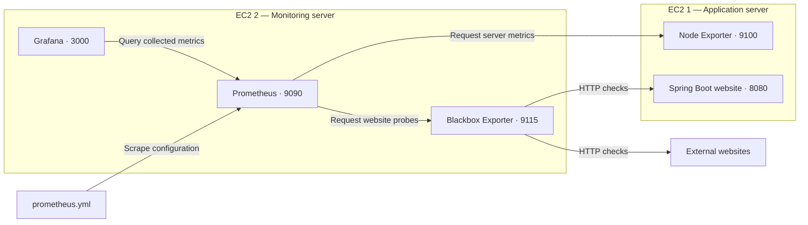

# 📊 Infrastructure Monitoring Solution Using Prometheus & Grafana

A monitoring solution on AWS EC2 that brings server resource metrics and website availability checks together in Grafana dashboards. It helps teams understand system behavior and investigate performance issues with clearer context.

---

## 🎯 Solution Overview

The solution provides:

- ✅ A Java Spring Boot website running on EC2 1.
- ✅ Node Exporter for CPU, memory, disk, and network metrics.
- ✅ Blackbox Exporter for website availability, HTTP status, and response timing.
- ✅ Prometheus for collecting and storing metrics every 15 seconds.
- ✅ Grafana with imported Node Exporter and Blackbox Exporter dashboards.
- ✅ Docker containers for the monitoring tools.

### The Problem It Addresses

A responsive website does not reveal whether its server is under resource pressure. Checking server metrics and website responses separately can make troubleshooting slower.

### How the Solution Helps

Prometheus collects server metrics and website probe results in one place. Grafana displays them in dashboards, helping teams compare resource usage with website availability and response times.

### Architecture

| Server | Components | Purpose |
|--------|------------|---------|
| **EC2 1 — Application server** | Java 17, Maven, Git, Spring Boot website, Node Exporter | Run the website and expose server metrics |
| **EC2 2 — Monitoring server** | Docker, Blackbox Exporter, Prometheus, Grafana | Check websites, collect metrics, and display dashboards |



The arrows show requests. Node Exporter and Blackbox Exporter return metrics to Prometheus; Prometheus returns query results to Grafana.

---

## 📋 Prerequisites

- Two Ubuntu EC2 instances with network access between them.
- SSH access to both servers and permission to use `sudo`.
- Java 17 JDK, Maven, and Git on EC2 1.
- Docker on both servers.
- A browser to open the website and monitoring pages.

### Server addresses

Replace these labels throughout the commands, URLs, and YAML, including the angle brackets:

| Label | Replace with |
|-------|--------------|
| `<EC2-1 App server IP>` | The address of the application server |
| `<EC2-2 Monitor server IP>` | The address of the monitoring server |

Use an address reachable from the component making the request. Browser access normally uses the EC2 public address. Private addresses can be used between servers when their network allows it.

### Network access

| Destination | TCP port | Required access |
|-------------|----------|-----------------|
| Both servers | 22 | SSH from your IP |
| EC2 1 | 8080 | Website access from your browser and EC2 2 |
| EC2 1 | 9100 | Prometheus on EC2 2 |
| EC2 2 | 9115 | Prometheus; your IP if checking Blackbox in a browser |
| EC2 2 | 9090 | Grafana; your IP for the Prometheus page |
| EC2 2 | 3000 | Your IP for Grafana |

Allow outbound traffic for package downloads, container images, and website probes. Restrict monitoring ports to the sources that need them.

---

## 🚀 Quick Start

### 1. Prepare EC2 1

Install the application build tools:

```bash
sudo apt update
sudo apt install -y openjdk-17-jdk maven git
```

Check the installation:

```bash
java -version
javac -version
mvn -version
git --version
```

### 2. Clone and Build the Application

**Run on EC2 1:**

```bash
git clone https://github.com/RichardL05/Prometheus_Grafana_Project.git
cd Prometheus_Grafana_Project
mvn clean verify
```

The build should finish with `BUILD SUCCESS`. The executable JAR is created in `target/`.

### 3. Start the Website

**Run on EC2 1, from the repository folder:**

```bash
java -jar target/database_service_project-0.0.5-SNAPSHOT.jar
```

Open `http://<EC2-1 App server IP>:8080/` in your browser. The BoardGame website should appear.

This command runs the application in the current terminal. Keep that session open and use another SSH session for the remaining EC2 1 commands.

### 4. Install Docker

**Run on both EC2 servers:**

```bash
sudo apt update
sudo apt install -y docker.io
sudo systemctl enable --now docker
sudo systemctl status docker
```

Docker should show `active (running)`.

### 5. Start Node Exporter

**Run on EC2 1:**

```bash
sudo docker run -d --name=node-exporter -p 9100:9100 --restart=always --pid="host" prom/node-exporter
sudo docker ps -a
```

Open `http://<EC2-1 App server IP>:9100/metrics` to view the exported metrics.

This command exposes Node Exporter through Docker. Because the host filesystem and network namespace are not mounted into the container, some filesystem and network metrics can reflect the container's view.

### 6. Start Blackbox Exporter

**Run on EC2 2:**

```bash
sudo docker run -d --name=blackbox-exporter --restart=always -p 9115:9115 prom/blackbox-exporter
sudo docker ps -a
```

Open `http://<EC2-2 Monitor server IP>:9115/` to view Blackbox Exporter.

### 7. Create the Prometheus Configuration

**Run on EC2 2:**

```bash
mkdir -p ~/monitoring
cd ~/monitoring
vi prometheus.yml
```

Paste the YAML from the **Prometheus Configuration** section below, replace the server address labels, and save the file before starting Prometheus.

### 8. Start Prometheus

**Run on EC2 2, from `~/monitoring`:**

```bash
sudo docker run -d --name=prometheus -p 9090:9090 -v "$(pwd)/prometheus.yml:/etc/prometheus/prometheus.yml" prom/prometheus
sudo docker ps -a
```

Open `http://<EC2-2 Monitor server IP>:9090/targets`. The configuration creates five scrape targets across three jobs.

An `UP` target means Prometheus successfully read the exporter response. For website health, also query `probe_success`; a value of `1` means the website probe succeeded.

### 9. Start Grafana

**Run on EC2 2:**

```bash
sudo docker run -d --name=grafana --restart=always -p 3000:3000 -v grafana-data:/var/lib/grafana grafana/grafana
sudo docker ps -a
```

Continue with **Grafana Setup** below.

---

## 📊 Monitoring Endpoints

| Service | Browser URL | Purpose |
|---------|-------------|---------|
| **Application** | `http://<EC2-1 App server IP>:8080/` | BoardGame website |
| **Node Exporter** | `http://<EC2-1 App server IP>:9100/metrics` | Server metrics |
| **Blackbox Exporter** | `http://<EC2-2 Monitor server IP>:9115/` | Website probe interface |
| **Prometheus** | `http://<EC2-2 Monitor server IP>:9090/` | Query collected metrics |
| **Prometheus Targets** | `http://<EC2-2 Monitor server IP>:9090/targets` | Scrape target status |
| **Grafana** | `http://<EC2-2 Monitor server IP>:3000/` | Monitoring dashboards |

---

## ⚙️ Prometheus Configuration

### prometheus.yml

```yaml
global:
  scrape_interval: 15s
  scrape_timeout: 10s

scrape_configs:
  - job_name: prometheus
    static_configs:
      - targets:
          - localhost:9090

  - job_name: node-exporter
    static_configs:
      - targets:
          - <EC2-1 App server IP>:9100

  - job_name: blackbox-exporter
    metrics_path: /probe
    params:
      module:
        - http_2xx
    static_configs:
      - targets:
          - http://<EC2-1 App server IP>:8080/
          - https://github.com/RichardL05/Prometheus_Grafana_Project
          - https://www.aabsweets.com/order/
    relabel_configs:
      - source_labels: [__address__]
        target_label: __param_target
      - source_labels: [__param_target]
        target_label: instance
      - target_label: __address__
        replacement: <EC2-2 Monitor server IP>:9115
```

`localhost:9090` refers to Prometheus itself inside its container. The other jobs use reachable EC2 addresses.

For website checks, Prometheus sends the website URL to Blackbox Exporter's `/probe` endpoint. Blackbox checks the website and returns the probe metrics. The `instance` label keeps the website URL visible in queries and dashboards.

After changing the configuration, check it and restart Prometheus:

```bash
sudo docker exec prometheus promtool check config /etc/prometheus/prometheus.yml
sudo docker restart prometheus
```

---

## 🖥️ Grafana Setup

### Connect Prometheus

1. Open `http://<EC2-2 Monitor server IP>:3000/`.
2. Sign in with `admin` / `admin` on the first login and set a new password.
3. Go to **Connections → Data sources → Add new data source**.
4. Select **Prometheus**.
5. Enter `http://<EC2-2 Monitor server IP>:9090/` as the Prometheus server URL.
6. Select **Save & test**. Confirm that Grafana successfully queries the Prometheus API.

Use the monitoring server's reachable address here. `localhost` inside Grafana refers to its own container.

### Import the Dashboards

These dashboards are community templates imported from Grafana's dashboard catalog.

| Dashboard | Import ID | Source |
|-----------|-----------|--------|
| **Node Exporter Full** | `1860` | [Grafana dashboard catalog](https://grafana.com/grafana/dashboards/1860-node-exporter-full/) |
| **Prometheus Blackbox Exporter** | `7587` | [Grafana dashboard catalog](https://grafana.com/grafana/dashboards/7587-prometheus-blackbox-exporter/) |

1. Go to **Dashboards → New → Import**.
2. Enter a dashboard ID and select **Load**.
3. Select the configured Prometheus data source when requested, then select **Import**.
4. Repeat for the other dashboard.
5. In Node Exporter Full, select the `node-exporter` job and the EC2 1 instance.
6. In the Blackbox dashboard, select the required website or **All** targets.
7. Set a recent time range, such as **Last 15 minutes**, to see the collected data clearly.

---

## 🐛 Troubleshooting

### Docker command not found on either server

**Cause:** Docker is not installed on the affected server.

**Fix:** Install Docker and start the service on the affected server.

```bash
sudo apt install -y docker.io
sudo systemctl enable --now docker
sudo systemctl status docker
```

### Website not accessible on port 8080

**Cause:** The application server's inbound rules do not allow TCP port `8080` from the required source.

**Fix:** Add an EC2 security group rule allowing TCP `8080` from the required source. Confirm that the Java application is running, then reopen `http://<EC2-1 App server IP>:8080/`.

### Prometheus opens, but the required targets are missing

**Cause:** The mounted `prometheus.yml` file is empty or does not contain the required scrape jobs. The interface can open without the intended targets being configured.

**Fix:** Add the YAML above to the mounted file, replace the address labels, validate it, and restart Prometheus.

```bash
sudo docker exec prometheus promtool check config /etc/prometheus/prometheus.yml
sudo docker restart prometheus
```

Check the **Targets** page again and query `probe_success` for website results.

---

## 📖 Documentation Links

- [Prometheus documentation](https://prometheus.io/docs/)
- [Node Exporter](https://github.com/prometheus/node_exporter)
- [Blackbox Exporter](https://github.com/prometheus/blackbox_exporter)
- [Grafana documentation](https://grafana.com/docs/)
- [Docker documentation](https://docs.docker.com/)

---

## 👥 Contributors

- **RichardL05** — Solution repository: [Prometheus_Grafana_Project](https://github.com/RichardL05/Prometheus_Grafana_Project).
- **Trainerstacks** — Original application source credited in the repository's existing README.
- **Grafana community dashboard authors** — Node Exporter Full and Prometheus Blackbox Exporter templates linked above.

---

## 📄 License

A separate license file has not been confirmed in this repository. Check the repository's license terms before reusing or distributing its code.

---

## 📞 Support

For solution issues or questions, [open a GitHub issue](https://github.com/RichardL05/Prometheus_Grafana_Project/issues).

---

**Deploy with confidence. Monitor with purpose. 🚀📊**
